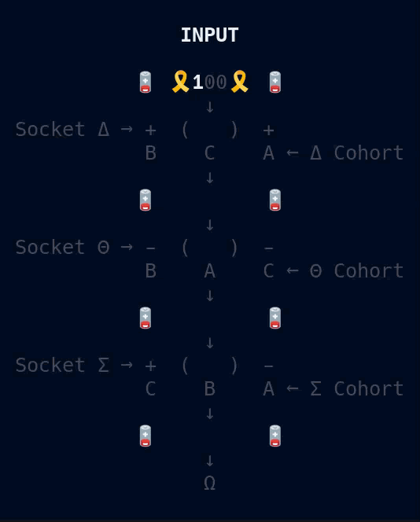
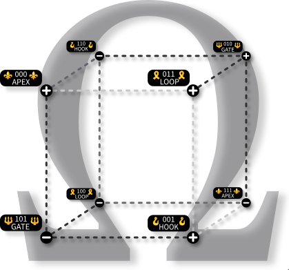

# 🔋 Nine-Volt 🔋

***...Distributed Boolean Circuit...***



> 😴 ***¿¿Oh...Was I XNORing...??*** 😴

---

## 🪫 PowerCycle 🪫


**NineVolt** is a small executable specimen of **Oblivious Compute**. Three **independent, headless observers** exchange positive and negative charges, forming **three distinct sockets** through different **Receiver** and **Helix** arrangements. Each socket creates a tiny **oblivious field**, where local admissibility drives a **VOLT** through the **three-bit hypercube**.

Every vertex has **three possible outcomes**, determined by the charges composing the socket. No observer represents the whole, and no fixed order of Helix contributions is required. **The admissible geometry of the cube determines the result.**


---

## 🧠 HeadSpace 🧠

***This section explores the consequences of organizing Boolean computation through geometric relationships.***

[**`HyperCube`**](./HyperCube.md) *describes how independent observers compute within a small geometric state space.*

[**`Potentiality`**](./Potentiality.md) *asks whether these fields might connect and compose into larger distributed machines.*

> ***Does organizing computation this way offer new possibilities, or merely move the complexity elsewhere?***

---



---

## 🐧 Operating System Support

- ✅ Linux  
- ✅ macOS  
- ❌ Windows (sorry, but not sorry)

---

## 🍄 Install

***To run 9Volt, install it with:***

```bash
pipx install 9volt && 9volt
```

You’ll need **Python 3.10+** and an **80x24 UNIX-like terminal environment.**

> Don't have **pipx**? See how to install it [**`Here`**](../../pipx.md).

---

## ☁️ Networking

**9Volt runs locally over UDP loopback sockets.**

---


---

⚡ [**`Prime`**](../Prime/README.md)***...***

---

## 📜 License

See the [**`NOTICE`**](../../NOTICE.md) for licensing information on the [**`Oblivious Compute`**](https://github.com/ObliviousCompute) project.

Use it, study it, modify it, just respect the terms outlined there.

