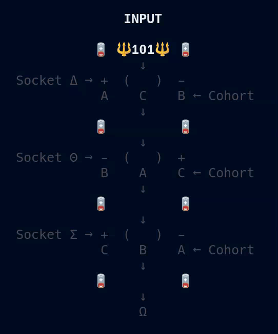

# 🔋 NineVolt 🔋

***Distributed Boolean Circuit***



> ***Oh...Was I XNORing???*** 😴

---

## 🪫 Recharge 🪫

**NineVolt** is a tiny executable specimen of **Oblivious Compute**. Three **independent observers** exchange positive and negative projections while maintaining their own states within a **three-bit hypercube**. Through the geometry of **Apex, Loop, Hook, and Gate**, local admissibility allows observers to walk, jump laterally, and capture charge. Together, they resolve a **⚡VOLT⚡** without any observer representing the entire configuration.

A projection does not become state merely because it arrives. Each observer admits only what belongs from its own **present position**. A spectator traces the evolving geometry through **Δ → Θ → Σ → Ω**, revealing eight possible words, each with three distinct outcomes across the polarity configurations. **The geometry is small, but its potential for composition is enormous. The words are not instructions for a separate computer. Their admissible relationships are the machine.**

---

## 🎛️ Eleven 🎛️

[**`HyperCube`**](./HyperCube.md) gives the relation a **Boolean language.**

> ***See the computation first. Then learn how it speaks.***

---

## 🐧 Operating System Support

- ✅ Linux  
- ✅ macOS  
- ❌ Windows (sorry, but not sorry)

---

## 🍄 Install

***To run 9Volt, install it with:***

```bash
pipx install 9volt && 9volt
```

You’ll need **Python 3.10+** and an **80x24 UNIX-like terminal environment.**

> Don't have **pipx**? See how to install it [**`Here`**](../../pipx.md).

---

## ☁️ Networking

**9Volt runs locally** over sockets as a **Smoketest**.

---

⚡ [**`Prime`**](../Prime/README.md)***...***

---

## 📜 License

See the [**`NOTICE`**](../../NOTICE.md) for licensing information on the [**`Oblivious Compute`**](https://github.com/ObliviousCompute) project.

Use it, study it, modify it, just respect the terms outlined there.

