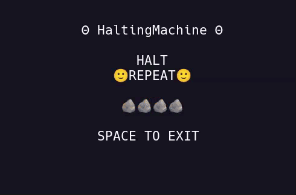

# 🙂 HaltingMachine 🙂

***...Rock. Paper. Scissors. Rock. Paper. Scissors...***  



> ***...Forever...and ever...*** 

---

## 🙃 Inverter 🙃

**HaltingMachine** is a tiny executable specimen of **Oblivious Compute**. Each terminal is an **independent observer** holding its own state. Normal observers move through **Rock → Paper → Scissors**, while the inverter moves through the **same state space in reverse**.

A projection does not become state merely because it was projected. Each observer admits only what belongs from its own **present position**, so the inverter may keep running while the surrounding field remains halted, or stop while the field continues to move it. **Local execution does not decide the computation. The relation among independently maintained states does.**

---

## 📦 Outside 📦

[**`BlackBox`**](./BlackBox.md) revisits **Turing's halting problem** as a thought experiment. Turing's diagonal argument establishes a limit on what a machine can decide. But what if the diagonal were expressed as **relational geometry among independent observers**, rather than represented within any single machine?

> ***If the computation exists between observers, what exactly is inside the box?***

---

## ⚙️ Mechanical Intuition ⚙️

> ***Several gears are suspended in an Oblivious Medium. Each gear knows only its own position and what may mesh from there. No gear contains the mechanism. The mechanism exists in the relation among them, while the medium merely exposes their positions. HaltingMachine makes this visible by turning the same three-state cycle in opposite directions. The observers may move differently, separate, and meet again in shared alignment. The computation is in the relation among their states, not in any one observer.***


---

## 🐧 Operating System Support

- ✅ Linux  
- ✅ macOS  
- ❌ Windows (sorry, but not sorry)

---

## 🍄 Install

***To run HaltingMachine, install it with:***

```bash
pipx install HaltingMachine && HaltingMachine
```

You’ll need **Python 3.10+** and an **80x24 UNIX-like terminal environment.**

> Don't have **pipx**? See how to install it [**`Here`**](../../pipx.md).

---

## ☁️ Networking

**HaltingMachine runs locally** over sockets as a **Smoketest**.

---

⚡ [**`9Volt`**](../9Volt/README.md)***...***

---

## 📜 License

See the [**`NOTICE`**](../../NOTICE.md) for licensing information on the [**`Oblivious Compute`**](https://github.com/ObliviousCompute) project.

Use it, study it, modify it, just respect the terms outlined there.

